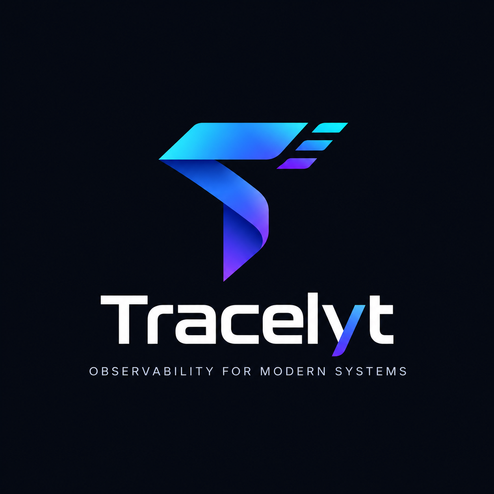

<p align="center">
  
</p>

<h1 align="center">Tracelyt Alerting</h1>

<p align="center">
  <strong>Alert Lifecycle and Incident State Management Subsystem for the Tracelyt Observability Platform</strong>
</p>

<p align="center">
  <a href="https://github.com/Tracelyt-Systems/tracelyt-alerting/actions/workflows/ci.yml">
    
  </a>
  <a href="LICENSE">
    
  </a>
  <a href=".java-version">
    
  </a>
  <a href="https://spring.io/projects/spring-boot">
    
  </a>
</p>

---

## 1. Project Identity & Purpose

**Tracelyt Alerting** (`tracelyt-alerting`) is the alert evaluation, alert lifecycle coordination, and incident-state management subsystem of the **Tracelyt** open-source observability platform. Its future responsibility is to provide a deterministic, multi-tenant engine that periodically evaluates alert conditions across metrics, logs, and distributed traces, tracks alert state transitions, deduplicates incidents, and emits notification intents to `tracelyt-notifications`.

> ### ⚠️ Project Status: Foundation & Architecture Setup
>
> **This repository is currently in its initial architectural setup phase (Stage 1).**
>
> - **Current Capabilities:** Reproducible Java 21 LTS + Spring Boot 3.4.3 application bootstrap, verified build automation, Checkstyle 10.21.4 rules, security threat modeling, missing data semantics, and CI workflows.
> - **Intentionally Not Implemented Yet:** No actual alert evaluation scheduling, no threshold logic, no database connections (PostgreSQL, MySQL), no Redis caching, no Kafka streaming, no incident creation APIs, no notification provider SDKs (Slack, PagerDuty, Email), and no mock endpoints returning fake alerts.
> - **Contract Governance:** All external API schemas, event envelopes, and error representations are governed by [`tracelyt-specs`](https://github.com/Tracelyt-Systems/tracelyt-specs).

---

## 2. Architecture Context Diagram

The following Mermaid diagram illustrates the conceptual future relationships between Alerting and the wider Tracelyt platform ecosystem.

```mermaid
flowchart TD
    subgraph Clients["Clients & External Consumers"]
        UI["Tracelyt Dashboard / Web UI"]
        CLI["Tracelyt CLI"]
    end

    subgraph ControlPlane["Identity & Governance Boundary"]
        CP["tracelyt-control-plane<br>(AuthN, AuthZ, Tenant Scope, Quotas)"]
    end

    subgraph SpecsBoundary["Canonical Contract Source of Truth"]
        Specs["tracelyt-specs<br>(Approved API Schemas & Event Envelopes)"]
    end

    subgraph AlertingSubsystem["tracelyt-alerting (This Subsystem)"]
        Bootstrap["Bootstrap & Health Probes<br><b>[Implemented]</b>"]
        Scheduler["Evaluation Scheduler & Jitter<br><i>[Planned - Stage 3]</i>"]
        Evaluator["Threshold & Condition Evaluator<br><i>[Planned - Stage 3]</i>"]
        IncidentMgr["Incident Deduplication & State<br><i>[Planned - Stage 4]</i>"]
        IntentGen["Notification Intent Generator<br><i>[Planned - Stage 5]</i>"]
    end

    subgraph QuerySubsystem["Query Execution Boundary"]
        QE["tracelyt-query-engine<br>(Bounded Analytical Queries)"]
    end

    subgraph DownstreamDelivery["Downstream Services"]
        Notif["tracelyt-notifications<br>(Slack, Email, PagerDuty, Webhooks)"]
        AI["tracelyt-ai-investigator<br>(Read-Only Incident Context)"]
    end

    subgraph StorageBackends["Analytical Storage (Managed by tracelyt-deploy)"]
        Storage[("Telemetry Storage<br>(ClickHouse, TSDB)")]
    end

    Specs -.->|Governs Schemas| AlertingSubsystem
    Specs -.->|Governs Schemas| ControlPlane
    Specs -.->|Governs Schemas| Notif

    UI -->|1. Configure Alert Rules & Silences| CP
    CP -->|2. Validated Rules with Tenant Scope| AlertingSubsystem
    AlertingSubsystem -->|3. Submit Bounded Evaluation Query| QE
    QE -->|Read Telemetry| Storage
    QE -->>|4. Return Result Points| AlertingSubsystem
    AlertingSubsystem -->|5. Condition Met: Emit Notification Intent| Notif
    AlertingSubsystem -.->|6. Provide Read-Only Incident Context| AI
```

---

## 3. Core Architectural Triad

To ensure modularity and clean engineering separation of concerns, Tracelyt divides alerting responsibilities across three strict boundaries:

1. **Alert Evaluation:** Determines *whether* a condition is satisfied by requesting bounded queries from `tracelyt-query-engine`. Owned by `tracelyt-alerting`.
2. **Alert Lifecycle:** Tracks *state* over time (`Normal` ➔ `Pending` ➔ `Firing` ➔ `Resolved`, deduplication, and silences). Owned by `tracelyt-alerting`.
3. **Notification Delivery:** Handles *transports* (Slack, SMTP, PagerDuty, retries, rate limits, provider credentials). Owned exclusively by `tracelyt-notifications`.

---

## 4. Getting Started

### Prerequisites
- **Java Development Kit (JDK):** Version 21 LTS (Oracle OpenJDK, Eclipse Temurin, or Microsoft Build of OpenJDK). Verify via `java -version`.
- **Git:** Version 2.30+.
- **Python:** Version 3.9+ (used for local documentation and linting validation).
- **Make:** Version 3.81+ (Optional developer convenience).

### Building & Validating Locally

The project includes the Apache Maven Wrapper for reproducible builds without requiring a pre-installed Maven binary.

```bash
# Clone the repository
git clone https://github.com/Tracelyt-Systems/tracelyt-alerting.git
cd tracelyt-alerting

# Validate formatting, Checkstyle, and run context smoke tests
# Linux / macOS:
./mvnw -B -ntp clean test checkstyle:check

# Windows (Command Prompt or PowerShell):
mvnw.cmd -B -ntp clean test checkstyle:check
```

### Running the Application Bootstrap

```bash
# Start the lightweight Spring Boot application (port 8084)
./mvnw spring-boot:run

# Verify actuator health probe in another terminal:
curl http://localhost:8084/actuator/health
# {"status":"UP"}
```

*Note: The bootstrap application verifies configuration loading and binds health endpoints. It does not accept rule configurations, evaluate queries, or connect to database/broker backends.*

---

## 5. Documentation Guide

The repository includes detailed architecture, security, and operational documentation:

| Category | Key Documents |
|---|---|
| **Architecture** | • [Architecture Overview](docs/architecture/overview.md)<br>• [System Boundaries](docs/architecture/system-boundaries.md)<br>• [Domain Model](docs/architecture/domain-model.md)<br>• [Alert Evaluation](docs/architecture/alert-evaluation.md)<br>• [Alert Lifecycle](docs/architecture/alert-lifecycle.md)<br>• [Incident Lifecycle](docs/architecture/incident-lifecycle.md)<br>• [Notification Boundary](docs/architecture/notification-boundary.md)<br>• [State Management](docs/architecture/state-management.md)<br>• [Distributed Evaluation](docs/architecture/distributed-evaluation.md)<br>• [Missing & Delayed Data](docs/architecture/missing-data.md)<br>• [Failure Model](docs/architecture/failure-model.md)<br>• [Scalability & Capacity](docs/architecture/scalability.md)<br>• [Technology Strategy](docs/architecture/technology-strategy.md)<br>• [Language Boundaries](docs/architecture/language-boundaries.md)<br>• [Storage Strategy](docs/architecture/storage-strategy.md) |
| **Decisions (ADRs)** | • [ADR Index](docs/decisions/README.md)<br>• [ADR-0001: Adopt Java 21 LTS + Spring Boot 3.4](docs/decisions/0001-adopt-java21-spring-boot-foundation.md) |
| **Security & Privacy** | • [Threat Model](docs/security/threat-model.md)<br>• [Tenant Isolation](docs/security/tenant-isolation.md)<br>• [Secure Development Lifecycle](docs/security/secure-development.md)<br>• [Data Privacy & Minimization](docs/security/data-privacy.md)<br>• [Supply Chain Hardening](docs/security/supply-chain.md) |
| **Operations** | • [Configuration Policy](docs/operations/configuration.md)<br>• [Subsystem Observability](docs/operations/observability.md)<br>• [Capacity Planning](docs/operations/capacity-planning.md)<br>• [Disaster Recovery](docs/operations/disaster-recovery.md)<br>• [Resource Limits & Quotas](docs/operations/resource-limits.md)<br>• [Deployment Readiness](docs/operations/deployment-readiness.md) |
| **Standards & Roadmap** | • [Contract Governance](docs/standards/contract-governance.md)<br>• [Compatibility Policy](docs/standards/compatibility.md)<br>• [Error Handling Standards](docs/standards/error-handling.md)<br>• [Performance Testing Standards](docs/standards/performance-testing.md)<br>• [Event Governance](docs/standards/event-governance.md)<br>• [Architecture Evolution Roadmap](docs/roadmap/architecture-evolution.md) |

---

## 6. Security & Vulnerability Reporting

Security is a primary design goal. Please review:
- [`SECURITY.md`](SECURITY.md) for vulnerability disclosure procedures.
- [`docs/security/threat-model.md`](docs/security/threat-model.md) for STRIDE threat analysis and planned mitigations.

**Please do not report security vulnerabilities through public GitHub issues.**

---

## 7. Contributing & Community

We welcome contributions! Please review our:
- [`CONTRIBUTING.md`](CONTRIBUTING.md) for development workflows and PR requirements.
- [`CODE_OF_CONDUCT.md`](CODE_OF_CONDUCT.md) for community standards.
- [`GOVERNANCE.md`](GOVERNANCE.md) for decision-making processes.
- [`MAINTAINERS.md`](MAINTAINERS.md) for current maintainer listings.
- [`SUPPORT.md`](SUPPORT.md) for getting help.

---

## 8. License

This project is licensed under the **Apache License, Version 2.0**. See [`LICENSE`](LICENSE) and [`NOTICE`](NOTICE) for details.
