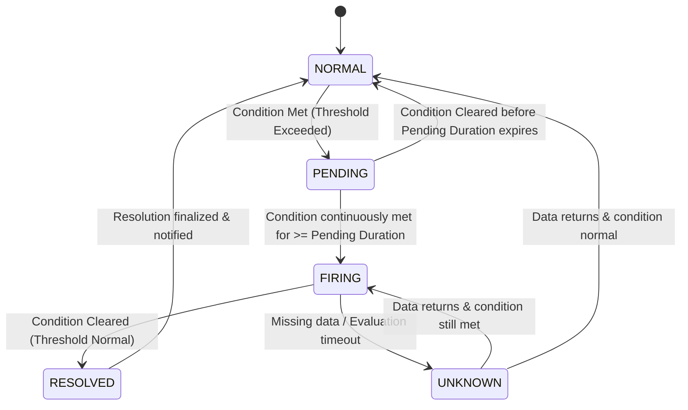

# Alert Lifecycle Architecture

This document describes the state machine, transition rules, orthogonal operational controls, and audit history requirements for `tracelyt-alerting`.

> **Status Notice:** This document establishes design specifications for alert lifecycles. No runtime state machines or transition engines are implemented in this repository foundation.

---

## 1. Separation of State Dimensions

A common anti-pattern in alerting systems is flattening all operational states into a single enum (e.g., trying to represent `FIRING`, `SILENCED`, `ACKNOWLEDGED`, and `DISABLED` in one field). Tracelyt strictly separates state into orthogonal dimensions:

| Dimension | Scope | Possible Values | Ownership |
|---|---|---|---|
| **Rule Configuration State** | The administrative status of the rule definition. | `ENABLED`, `DISABLED`, `VALIDATION_FAILED` | User / Admin via Control Plane |
| **Condition (Evaluation) State** | The mathematical truth of the query condition. | `NORMAL`, `PENDING`, `FIRING`, `RESOLVED`, `UNKNOWN` | Evaluator Worker |
| **Operational Control State** | Human or automated suppression applied to the instance. | `ACTIVE`, `SILENCED`, `MUTED`, `INHIBITED` | Operator / Silence Rule |
| **Incident Management State** | Triage and remediation progress. | `UNASSIGNED`, `ACKNOWLEDGED`, `INVESTIGATING`, `RESOLVED`, `CLOSED` | SRE / Incident Responder |

---

## 2. Condition State Machine

### Transition Semantics
1. **`NORMAL ➔ PENDING`:** Occurs on the first evaluation where the query value breaches the threshold. The transition records the initial breach timestamp.
2. **`PENDING ➔ FIRING`:** Occurs only when the condition remains continuously satisfied for the duration specified by `pendingDuration` (the `for` clause). This eliminates alerting noise from brief transient spikes.
3. **`FIRING ➔ RESOLVED`:** Occurs when an evaluation confirms the metric or condition has returned to normal bounds. Triggers a resolution notification intent.
4. **`FIRING ➔ UNKNOWN`:** Occurs when telemetry is absent or query times out. The system applies the configured `on_missing_data` policy (see [Missing Data](missing-data.md)).

---

## 3. Orthogonal Controls (Suppression & Invalidation)

- **Silences (Muting):** Temporarily suppresses outgoing notifications for alerts matching specific label selectors without stopping rule evaluation or erasing incident history.
- **Inhibition:** Suppresses lower-severity alerts (e.g., `WARNING`) if a related high-severity alert (e.g., `CRITICAL` node failure) is already firing for the same cluster/service.
- **Disabled:** Suspends query execution entirely for a rule, freeing scheduler resources during maintenance.
