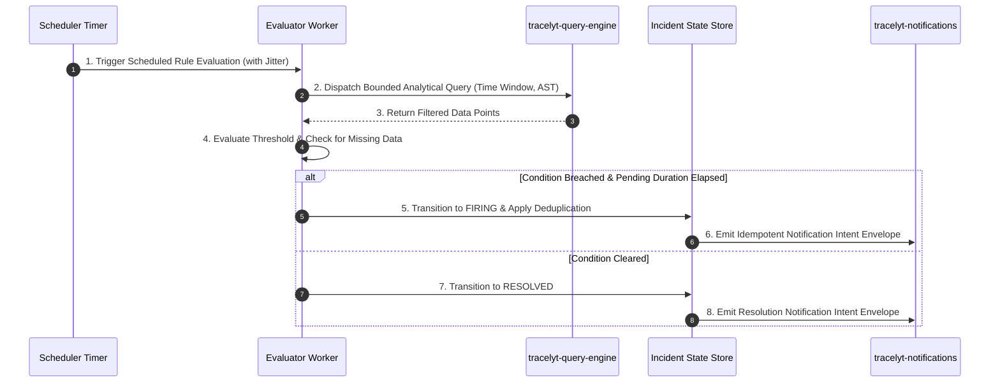

# Architecture Diagrams

This directory maintains visual Mermaid diagrams illustrating the planned topology, execution sequence, and trust boundaries for `tracelyt-alerting`.

---

## 1. Subsystem Trust Boundaries

```mermaid
flowchart TD
    subgraph UntrustedZone["Untrusted External Zone"]
        UserBrowser["Web Browser / Dashboard User"]
    end

    subgraph EdgeBoundary["Edge Authentication Boundary"]
        CP["tracelyt-control-plane<br>(Validates JWT, Checks Tenant Roles)"]
    end

    subgraph InternalAlertingBoundary["Internal Alerting Subsystem"]
        Scheduler["Alert Scheduler<br>(Jitter Allocation & Rate Limits)"]
        Evaluator["Alert Evaluator<br>(Condition & Missing Data Logic)"]
        IncidentMgr["Incident Manager<br>(Deduplication & State Transitions)"]
    end

    subgraph InternalPlatformServices["Internal Service Boundary"]
        QE["tracelyt-query-engine<br>(Telemetry Queries)"]
        Notif["tracelyt-notifications<br>(Channel Delivery)"]
        AI["tracelyt-ai-investigator<br>(Context Consumer)"]
    end

    UserBrowser -->|1. Create Alert Rule| CP
    CP -->|2. Trusted Rule with Verified Tenant Claims| Scheduler
    Scheduler -->|3. Evaluate Query| QE
    QE -->>|4. Return Results| Evaluator
    Evaluator -->|5. Condition Met| IncidentMgr
    IncidentMgr -->|6. Notification Intent| Notif
    IncidentMgr -.->|7. Read-Only Context| AI
```

---

## 2. End-to-End Evaluation & Notification Sequence


