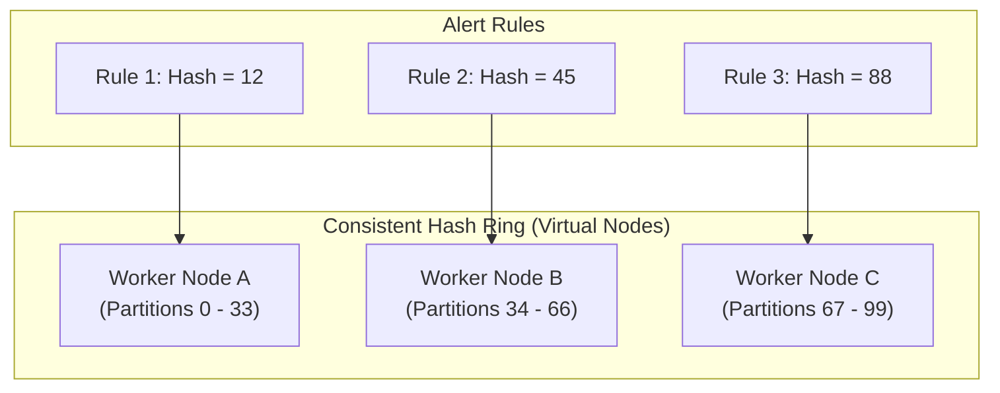

# Distributed Evaluation Architecture

This document evaluates the trade-offs between single-process and distributed alert evaluation, detailing rule partitioning, worker leasing, and failure recovery.

> **Architectural Principle:** Do not introduce distributed coordination (Raft, ZooKeeper, etcd) prematurely. For moderate workloads (< 5,000 alert rules), a resilient, vertically-scaled single-process evaluator with lightweight database leases provides vastly superior operational simplicity, zero split-brain hazards, and negligible latency.

---

## 1. Single-Process vs. Distributed Evaluation Topology

| Dimension | Single-Process Coordinator | Distributed Multi-Worker Topology |
|---|---|---|
| **Rule Capacity** | Up to ~5,000 rules evaluated per minute | 5,000 to 100,000+ rules evaluated per minute |
| **Operational Complexity** | Very Low: Single container deployment, zero consensus protocol | High: Requires dynamic sharding, heartbeats, and rebalancing |
| **Failure Mode** | Container restart recovery via database state | Worker partition failover, distributed lease re-assignment |
| **Consensus Needs** | Simple database row lock / lease | Distributed hash ring or external coordinator (e.g., etcd/Redis) |
| **Current Foundation Status** | **Approved Initial Architecture** | **Deferred to Stage 6 (Scale & Reliability)** |

---

## 2. Distributed Work Partitioning (Future Stage 6 Design)

When scale requires horizontal worker distribution, rule evaluation is partitioned using **Consistent Hashing**:

### Key Partitioning Rules
1. **Tenant Co-Location:** Rules belonging to the same tenant and project are hashed to ensure they execute on the same worker, enabling local state caching and unified tenant rate limiting.
2. **Lease Heartbeats:** Workers periodically renew short-lived leases (e.g., 30-second lease with 5-second heartbeats). If a worker crashes, expired leases are reclaimed by remaining healthy nodes.
3. **Graceful Handoff:** On worker shutdown (`SIGTERM`), the node yields its active leases and finishes in-flight evaluations before exiting.
