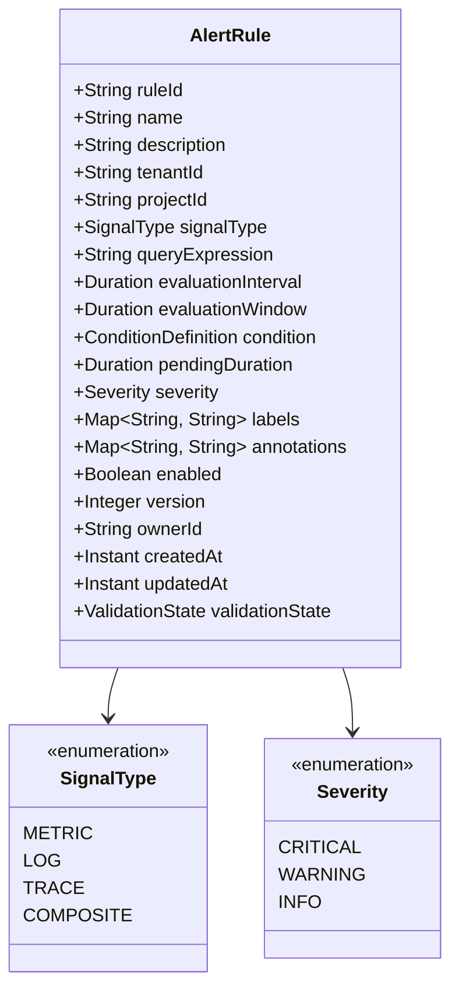

# Alerting Domain Model

This document outlines the core domain entities, alert rule structures, signal categories, and versioning models planned for `tracelyt-alerting`.

> **Governance Notice:** Concrete JSON and Protobuf schemas for these domain entities must be reviewed and approved in [`tracelyt-specs`](https://github.com/Tracelyt-Systems/tracelyt-specs). This document defines the conceptual domain model.

---

## 1. Alert Rule Specification (Conceptual Model)

An **Alert Rule** is a declarative policy defining an observability condition to be evaluated periodically.

### Key Field Descriptions
- `evaluationInterval`: How often the query executes (e.g., every 60 seconds).
- `evaluationWindow`: The sliding time range scanned per evaluation (e.g., last 5 minutes).
- `pendingDuration` (`for` clause): How long the condition must continuously evaluate as satisfied before the alert transitions from `Pending` to `Firing` (prevents flapping from brief transient spikes).
- `ruleVersion`: Monotonically increasing version integer. Essential for auditability: when an alert fires, it records the exact `ruleVersion` that triggered it.

---

## 2. Signal Types & Evaluation Semantics

| Signal Category | Evaluation Characteristics | Missing Data Behavior | High-Cardinality Safeguards |
|---|---|---|---|
| **Metric Alerts** | Evaluates numeric time-series values against thresholds (`>`, `<`, `==`, `!=`). Handles rate of change (`rate()`) and gauge levels. | Missing series can indicate instance death or normal silence. Requires explicit `on_missing_data` policy (`alert`, `resolve`, `ignore`). | Grouping labels must be restricted to approved dimensions (e.g., `service`, `region`), avoiding user IDs. |
| **Log Alerts** | Evaluates event frequencies, error rate spikes, or regex log pattern occurrences within sliding time windows. | Absence of log lines typically indicates normal healthy operation (zero matches = normal). | Wildcard regexes are evaluated with bounded execution engines (RE2) to prevent ReDoS. |
| **Trace Alerts** | Evaluates P95/P99 latency thresholds or span error rates derived from distributed trace graphs. | Trace sampling rates must be accounted for (low-sample environments require statistical confidence weighting). | Span attributes must be aggregated at the service and endpoint level. |
| **Composite Alerts** | Boolean logic combining multiple condition states (e.g., `MetricA > 90% AND LogErrors > 100/min`). | Evaluates compound truth tables. If one condition fails due to missing data, composite policy determines fallback. | Directed Acyclic Graph (DAG) validation ensures zero circular dependencies between sub-rules. |

---

## 3. Why Rule Versioning and Validation Matter

1. **Deterministic Incident Triage:** When an incident triggers at 02:00 AM, engineers need to know the *exact rule definition* in effect at that moment, even if an engineer updated the threshold at 08:00 AM the following morning.
2. **Safe Rollbacks:** Versioned rule definitions allow instant rollback to previous rule configurations without database schema mutations.
3. **Pre-Flight Validation:** Rules must be validated at creation time (syntax checking, query parsing, and interval feasibility) to prevent scheduling un-executable queries that burn CPU resources.
