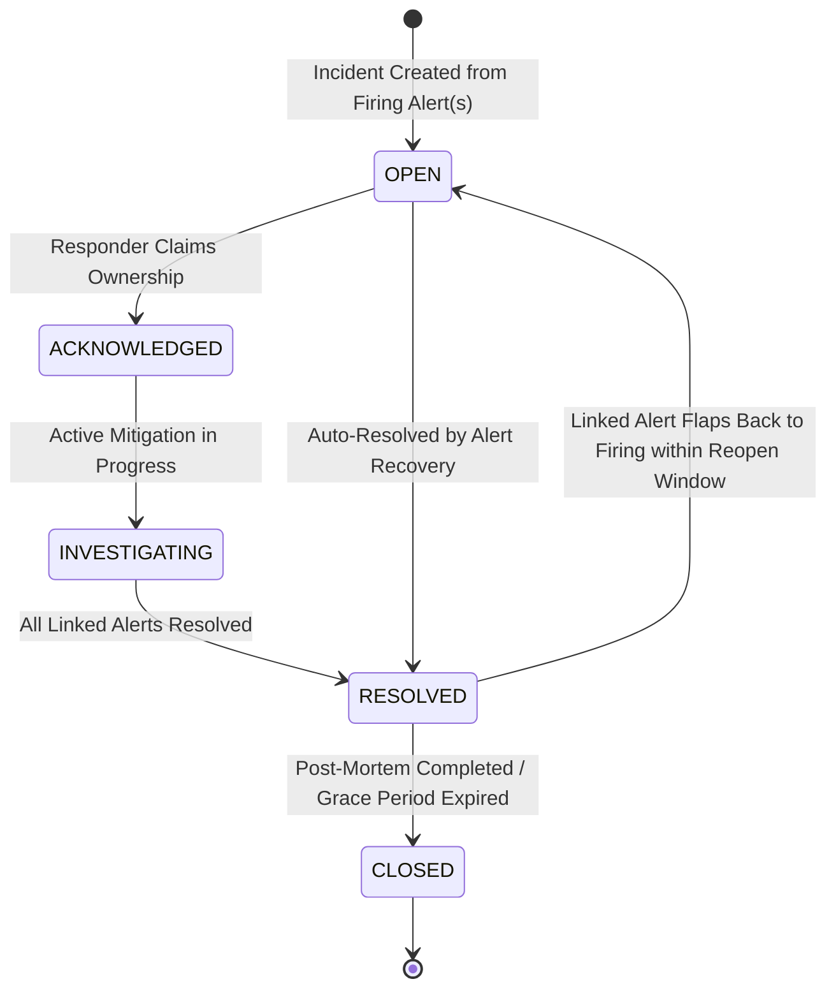

# Incident Lifecycle & Deduplication Architecture

This document describes the relationship between firing alert instances and incident records, covering deduplication, grouping keys, triage lifecycles, and timeline auditing.

> **Status Notice:** This document establishes design specifications for incident management. No working incident managers, ticket creation workflows, or persistence tables are implemented in this repository foundation.

---

## 1. Distinction: Alert vs. Incident

- **Alert Instance:** An ephemeral, point-in-time signal indicating that a specific rule condition is satisfied for a specific set of dimension labels (e.g., `cpu_utilization > 95% on host-01`).
- **Incident:** A persistent, aggregated operational event that requires human or automated investigation. An incident groups multiple related alert instances across services, nodes, and time into a single actionable record.

> **Key Rule:** Not every firing alert creates a new incident. If an existing open incident shares the same grouping key (e.g., `service=payment, region=us-east`), newly firing alerts are attached to that existing incident as supporting evidence.

---

## 2. Grouping & Deduplication Keys

To prevent notification storms and fragmented incident queues, alerts are mapped to incidents via a deterministic **Group Key**:

$$\text{GroupKey} = \text{Hash}(\text{tenant\_id}, \text{project\_id}, \text{group\_by\_labels})$$

### Example:
- Alert 1 fires: `service=order-api, host=node-01, severity=CRITICAL`
- Alert 2 fires: `service=order-api, host=node-02, severity=CRITICAL`
- Alert 3 fires: `service=order-api, host=node-03, severity=CRITICAL`
- **Result:** Instead of paging an on-call engineer 3 times, a single Incident is created for `service=order-api` with 3 linked alert instances.

---

## 3. Incident Lifecycle State Transitions

### State Definitions
- **`OPEN`:** Incident created; on-call responders notified via notification intent.
- **`ACKNOWLEDGED`:** A responder has claimed ownership, halting escalation policies.
- **`INVESTIGATING`:** Active debugging underway; linked to investigation context from `tracelyt-ai-investigator`.
- **`RESOLVED`:** All underlying alert instances have transitioned to `NORMAL` / `RESOLVED`.
- **`CLOSED`:** Final administrative state after post-incident review.
- **Reopening Policy:** If a linked alert resumes firing within a configurable grace window (e.g., 15 minutes after resolution), the incident reopens rather than creating a duplicate ticket.
