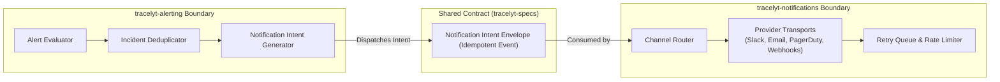

# Notification Boundary Architecture

This document establishes the architectural boundary, contract responsibilities, and event exchange protocols between `tracelyt-alerting` and `tracelyt-notifications`.

---

## 1. Boundary Division of Responsibilities



### Alerting Subsystem Responsibilities (The "WHAT & WHY")
- Evaluates whether an alert condition warrants notification.
- Identifies the triggering incident and associated alert metadata.
- Determines event classification: `ALERT_TRIGGERED`, `ALERT_RESOLVED`, `INCIDENT_ESCALATED`.
- Computes the deduplication fingerprint to avoid duplicate notifications.
- Specifies destination channel references (e.g., routing channel ID `dest_ops_slack`).
- Emits a structured, immutable **Notification Intent** event.

### Notifications Subsystem Responsibilities (The "HOW")
- Resolves destination channel references to concrete provider secrets (OAuth tokens, webhook URLs, SMTP credentials).
- Manages transport protocols (Slack Web API, SendGrid, Twilio, HTTPS webhooks).
- Implements provider-specific rate limiting, backoff, and delivery retries.
- Tracks delivery receipts and provider failure logs.

---

## 2. Notification Intent Contract (Conceptual Schema)

The intent envelope emitted by Alerting is governed by `tracelyt-specs`:

```json
{
  "intent_id": "notif_9b8a7c6d5e4f",
  "deduplication_key": "dedup_f7e6d5c4b3a2",
  "tenant_id": "tenant_prod_01",
  "project_id": "proj_payments",
  "event_type": "ALERT_TRIGGERED",
  "severity": "CRITICAL",
  "incident_id": "inc_1a2b3c4d5e",
  "rule_id": "rule_high_error_rate",
  "rule_version": 3,
  "title": "Payment API error rate > 5%",
  "summary": "Service order-payment error rate is 8.4% over 5m window on us-east",
  "labels": {
    "service": "order-payment",
    "environment": "production",
    "region": "us-east"
  },
  "destination_ref": "channel_tier1_oncall",
  "created_at": "2026-10-30T10:15:00Z"
}
```

---

## 3. Delivery Failure vs. Alert Resolution Semantics

- **Delivery Failure Independence:** If `tracelyt-notifications` fails to deliver a Slack message due to a third-party Slack API outage, the alert state in `tracelyt-alerting` remains **`FIRING`**. The alerting state represents physical observability truth and must never be altered by downstream delivery transport failures.
- **Recovery Notifications:** When an incident resolves, a corresponding `ALERT_RESOLVED` intent is emitted using the exact same `deduplication_key`, enabling notifications to thread resolution messages cleanly into the original Slack thread or PagerDuty incident.
