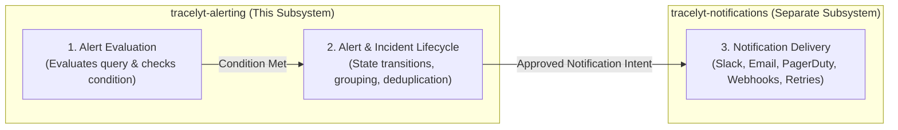
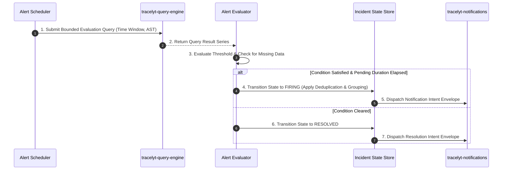

# Architecture Overview: Tracelyt Alerting

This document outlines the architectural role, design principles, and subsystem boundaries of `tracelyt-alerting` within the Tracelyt Observability Platform.

---

## 1. Subsystem Identity & Purpose

**Tracelyt Alerting** is the alert rule evaluation, alert lifecycle coordination, and incident-state management subsystem of the Tracelyt platform.

Its primary responsibility is to provide a deterministic, multi-tenant, and fault-tolerant engine that:
1. Periodically evaluates declarative alert rules across metrics, logs, and distributed trace data.
2. Manages alert instance state transitions (`Normal` ➔ `Pending` ➔ `Firing` ➔ `Resolved`).
3. Aggregates firing alerts into actionable incident records, applying deduplication, grouping, and suppression.
4. Produces validated **notification intents** dispatched to `tracelyt-notifications` for actual delivery.

> **Status Notice:** This repository is currently in **Stage 1 (Foundation)**. No alert evaluation schedulers, threshold logic, incident creation APIs, or database connections are implemented.

---

## 2. Core Architectural Triad

To ensure long-term maintainability and prevent monolithic coupling, Tracelyt enforces strict architectural separation between three distinct concerns:

1. **Alert Evaluation:** Determines *whether* an alert condition is satisfied by requesting bounded telemetry queries from `tracelyt-query-engine`. Owned by `tracelyt-alerting`.
2. **Alert Lifecycle:** Tracks *state* over time (pending durations, firing events, deduplication, resolution, and suppression). Owned by `tracelyt-alerting`.
3. **Notification Delivery:** Handles *transports* (SMTP, Slack webhooks, SMS, delivery retries, provider rate limits, credential storage). Owned exclusively by `tracelyt-notifications`.

---

## 3. High-Level Subsystem Flow

