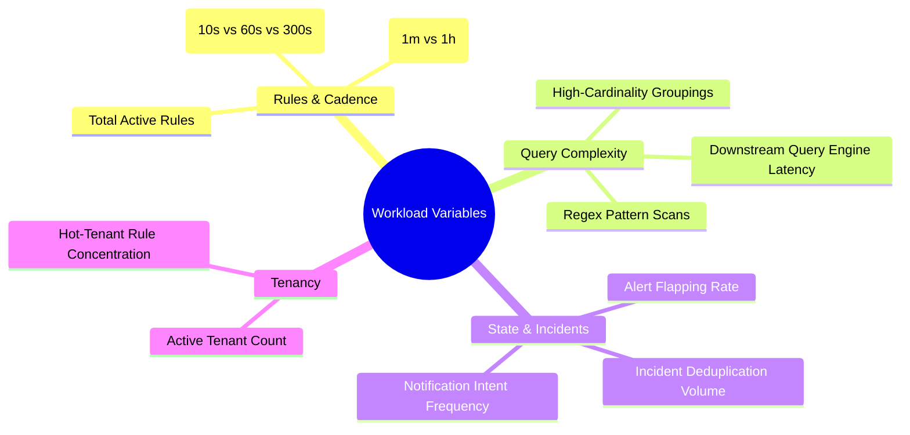

# Scalability & High-Concurrency Architecture

This document analyzes the multi-dimensional workload variables, worker concurrency models, and tenant isolation mechanisms governing `tracelyt-alerting`.

> **Status Notice:** No synthetic performance benchmarks, fake throughput claims, or artificial queries-per-second (QPS) numbers are included in this document. Real capacity limits must be empirically measured against actual workloads in future stages.

---

## 1. Multi-Dimensional Workload Variables

Sizing an alert evaluation subsystem is determined by multiple interdependent variables:

---

## 2. Horizontal Scaling & Evaluation Sharding

When total rule count exceeds single-node capacity (~5,000 rules), the system scales horizontally using **Tenant-Aware Partitioning**:

1. **Partition Assignment:** Rules are grouped into virtual partition buckets. Evaluator nodes dynamically claim partition leases using distributed locking or database lease records.
2. **Hot-Tenant Protection:** If a single tenant provisions 10,000 rules, those rules are isolated onto dedicated worker pools to prevent noisy-neighbor starvation of smaller tenants.
3. **Queue Backpressure:** Each worker maintains bounded execution queues. If worker thread utilization exceeds 85%, scheduling queues reject ad-hoc evaluation requests and log capacity alerts.
