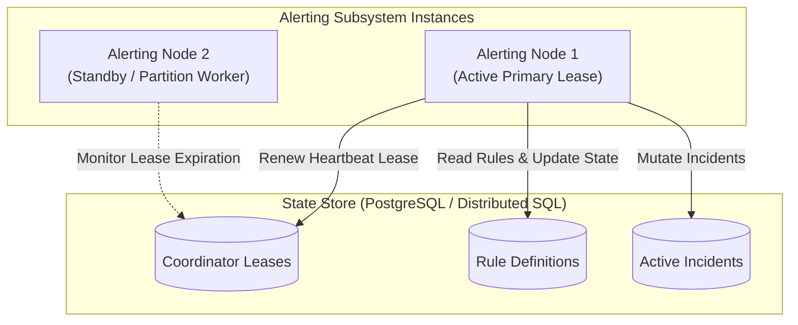

# Disaster Recovery & High Availability

This document outlines the high-availability topology, worker failover procedures, database recovery, and operational continuity strategies for `tracelyt-alerting`.

---

## 1. High Availability Architecture

To guarantee continuous monitoring without single points of failure:
- **Active-Standby with Database Leases (Initial Stage 3 Topology):** Multiple alerting coordinator instances run in parallel. A primary coordinator holds an active database lease. If the primary fails to heartbeat within 15 seconds, a standby node claims the lease and resumes scheduled evaluations from the last persisted checkpoint.
- **Active-Active Distributed Partitioning (Stage 6 Topology):** Multiple worker nodes co-exist, each claiming distinct rule partition hash buckets. Worker heartbeats are tracked in persistent storage or distributed KV leases.

---

## 2. Failure Scenarios & Recovery Procedures

### 2.1 Complete Alerting Coordinator Crash
- **Symptoms:** Coordinator stops emitting evaluation heartbeats; health probes fail.
- **Automated Recovery:** Kubernetes terminates the crashed pod. Standby node detects expired lease, reloads active rules and firing states from the persistent state store, and resumes scheduled evaluations within 15 seconds.
- **Incident Integrity:** Active firing incidents remain intact in the database; no duplicate notification storm occurs because deduplication keys persist.

### 2.2 Downstream Query Engine Failure
- **Symptoms:** High rate of evaluation query timeouts; query engine connection pool exhausted.
- **Mitigation:** Circuit breakers trip to prevent thread starvation. Alert evaluator preserves active alert states (does not auto-resolve), logs system warnings, and retries on the next scheduled interval.

### 2.3 Persistent Database Outage
- **Symptoms:** Evaluator unable to read rules or commit incident state transitions.
- **Mitigation:** In-flight evaluators log database connectivity alerts. The health readiness probe (`/actuator/health/readiness`) transitions to `DOWN`, notifying load balancers and orchestrators immediately.

---

## 3. Data Durability & Backup Responsibilities

Alert rule definitions, version histories, incident logs, and audit trails must be protected by standard enterprise disaster recovery practices:
- Automated continuous write-ahead log (WAL) archiving and daily point-in-time recovery (PITR) snapshots managed via `tracelyt-deploy`.
