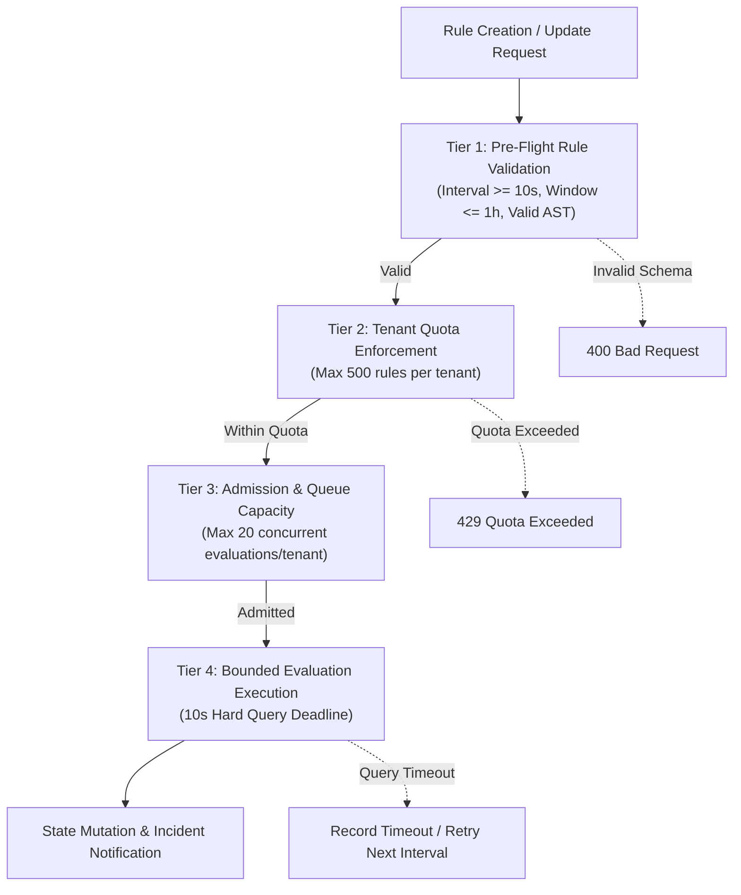

# Resource Limits, Quotas & Execution Safeguards

This document defines the admission control policies, execution budgets, deadline enforcement mechanisms, and tenant quota safeguards for `tracelyt-alerting`.

> **Status Notice:** This document establishes design specifications for alerting safety and quotas. No runtime rate limiters or query execution budgets are implemented in this repository foundation.

---

## 1. Multi-Tiered Safeguard Model

---

## 2. Limit Specifications

| Safeguard | Target Threshold | Action Upon Violation | Rationale |
|---|---|---|---|
| **Minimum Evaluation Interval** | 10 seconds | Reject rule creation with `400 Bad Request` | Prevents sub-second evaluation loops that saturate downstream query engines. |
| **Maximum Evaluation Window** | 1 hour (Default: 5–15 minutes) | Reject rule creation with `400 Bad Request` | Restricts telemetry scan size and memory consumption during evaluation. |
| **Execution Query Deadline** | 10 seconds hard timeout | Terminate downstream query; log timeout event | Frees worker threads from queries stuck in storage locks. |
| **Max Concurrent Queries per Tenant** | 20 concurrent executions | Defer low-priority rules to next scheduled cycle | Enforces fairness across multi-tenant environments. |
| **Maximum Rules per Tenant** | 500 active rules per project | Reject rule creation with `429 Quota Exceeded` | Protects scheduler memory and database connection pools. |
| **Max Incidents per Minute (Rate Cap)** | 100 new incidents per minute | Suppress non-critical notifications; emit rate-limit alert | Protects on-call engineers from notification flooding during cascading outages. |

---

## 3. Client Cancellation & Shutdown Propagation

When an alerting worker node receives `SIGTERM` during rolling updates:
1. The scheduler immediately stops picking up new evaluation cycles.
2. In-flight evaluations are granted a 30-second graceful shutdown grace period to complete and persist state checkpoints.
3. Unfinished evaluations are aborted, releasing database leases so surviving nodes can claim and evaluate them immediately.
