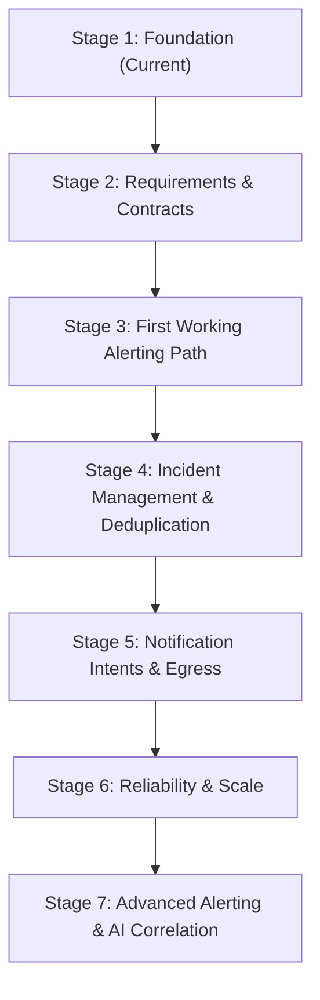

# Architecture Evolution: Future Stages

This document outlines the planned evolutionary stages for transitioning `tracelyt-alerting` from an architectural foundation into a production-grade alerting and incident-state management subsystem.

> **Roadmap Disclaimer:** This represents a conceptual engineering roadmap, not a commitment to delivery dates or fixed features. Each stage requires explicit maintainer review, ADR approval, and benchmark validation before implementation begins.

---

## Evolution Stages Overview

---

## Stage 1 — Repository Foundation (Current Baseline)
- **Status:** Complete.
- **Objectives:**
  - Establish repository foundation, directory structure, build automation, and code formatting tooling.
  - Implement minimal Java 21 LTS + Spring Boot 3.4.3 application bootstrap with verified smoke tests.
  - Define architectural boundaries, security threat model, missing data semantics, and storage strategy.
  - Establish contract governance pointing to `tracelyt-specs` as canonical authority.
- **Implementation Boundary:** Zero alert evaluation, zero database drivers, zero mock endpoints.

---

## Stage 2 — Requirements & Shared Contracts
- **Status:** Planned (Next Milestone).
- **Prerequisites:** Maintainer consensus on initial target alert use cases.
- **Objectives:**
  - Define concrete alert use cases (e.g., metric threshold breach).
  - Review and approve alert rule and incident schemas in `tracelyt-specs`.
  - Finalize tenant authentication context propagation contracts with `tracelyt-control-plane`.
  - Finalize missing-data policy representations and lifecycle event schemas.
- **Implementation Boundary:** Contract definitions and schema models only.

---

## Stage 3 — First Working Alerting Path
- **Status:** Future.
- **Prerequisites:** Stage 2 contracts approved; explicit maintainer implementation approval.
- **Objectives:**
  - Implement one narrowly scoped evaluation path (e.g., metric threshold condition).
  - Integrate with `tracelyt-query-engine` for bounded query execution.
  - Implement in-memory state tracking (`Normal` ➔ `Pending` ➔ `Firing`).
  - Introduce relational database persistence for rule definitions and alert instances.
  - Validate with automated end-to-end integration tests using ephemeral test containers.

---

## Stage 4 — Incident Management & Deduplication
- **Status:** Future.
- **Prerequisites:** Stage 3 single alert path verified in testing environments.
- **Objectives:**
  - Implement alert grouping keys (`GroupKey`) and incident deduplication logic.
  - Provide incident state lifecycle (acknowledgement, investigation, resolution, reopening).
  - Add optimistic concurrency control for concurrent incident updates.
  - Introduce append-only incident timeline audit logging.

---

## Stage 5 — Notification Intents & Egress
- **Status:** Future.
- **Prerequisites:** Stage 4 incident deduplication complete.
- **Objectives:**
  - Generate idempotent notification intent envelopes.
  - Establish asynchronous event dispatch to `tracelyt-notifications`.
  - Implement resolution notification pairing and delivery feedback tracking.

---

## Stage 6 — Reliability & Horizontal Scaling
- **Status:** Future.
- **Prerequisites:** Evaluation workload exceeds single-node capacity (> 5,000 active rules).
- **Objectives:**
  - Introduce distributed rule partitioning using consistent hashing.
  - Implement worker lease renewal and automatic heartbeat failover.
  - Deploy per-tenant concurrency quotas and scheduler backpressure.
  - Benchmark against high-flapping telemetry datasets under sustained load.

---

## Stage 7 — Advanced Alerting & AI Investigation
- **Status:** Long-Term Vision.
- **Prerequisites:** Proven production stability across Stages 3 through 6.
- **Objectives:**
  - Multi-condition composite rules and Directed Acyclic Graph (DAG) validation.
  - Advanced suppression rules, inhibition hierarchies, and calendar maintenance windows.
  - Integration with `tracelyt-ai-investigator` providing read-only incident summaries and context.
